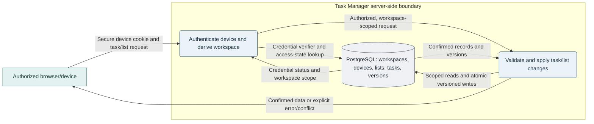
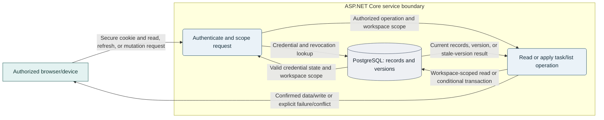
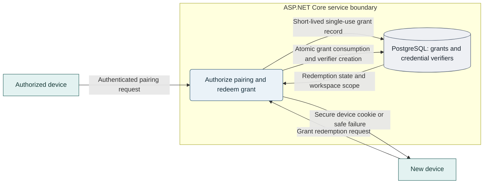
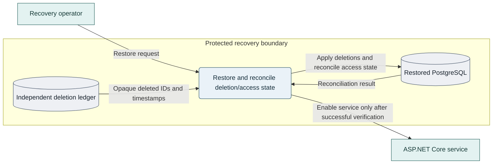

# Task Manager Architecture

**Status:** Approved by @cjschaab (product owner and technical lead) on 2026-11-13; G0 remains open pending VS-01 specification approval  
**Version:** 0.4  
**Date:** 2026-11-13  
**Approval record:** @cjschaab confirmed product-owner, security-owner, and technical-lead roles and approved PRD v0.8 and the architecture direction on 2026-11-13. This architecture approval does not approve later-slice policies or substitute for vertical-slice specifications.
**Product basis:** [Task Manager Product Requirements Specification](task-manager-requirements.md), version 0.8, approved by product owner @cjschaab on 2026-11-13.

## Goals and constraints

This design records the architecture approved by the technical lead and is grounded in approved PRD v0.8 and repository guidance. Product decisions for VS-01 are approved; later-slice and pilot policies remain pending their accountable owners.

### Goals

- Provide the in-scope task and list workflows from authorized browsers and devices.
- Keep workspace isolation, version-aware writes, explicit error states, and recoverability as core design constraints.
- Start with a deployment that is straightforward to operate and can be evaluated against pilot measurements.

### Known constraints and assumptions

- The pinned baseline selects .NET SDK 10.0.403 / ASP.NET Core 10, EF Core 10.0.15, Npgsql EF Core provider 10.0.3, PostgreSQL 18, React 19.3.1, TypeScript 7.0.2, Vite 8.3.8, and Node.js 26.13.1. Backend tests use xUnit 2.9.3 and `WebApplicationFactory`; PostgreSQL tests use a disposable PostgreSQL 18.7 container; frontend tests use Vitest 5.1.0, React Testing Library 16.3.3, and Playwright 1.65.0. Exact package dependencies are lockfile-pinned.
- Backend guidance specifies one modular web application/API. This draft keeps one backend deployment and recommends serving the React assets from it.
- The PRD v0.8 product scope and defaults are approved; candidate pilot service targets and later-slice security/operations decisions remain subject to their stated gates.
- No application code, deployed system, workload measurements, budget, or hosting environment was available for this design.
- The proposed single-deployable layout is an architectural recommendation. It does not select a cloud provider, container runtime, database hosting model, or operations owner.

## Architecture overview

### Recommended option: one deployable modular application

Deploy one ASP.NET Core application/API with the compiled React application served from the same origin. Use PostgreSQL as the authoritative application store. Keep application behavior divided into clear feature boundaries; do not split the backend into independently deployed services for the initial scope.

The browser is untrusted. The ASP.NET Core service is responsible for authenticating each device, deriving the authorized workspace, validating requests, applying business rules, and returning explicit outcomes. PostgreSQL is not exposed to the browser. The deletion ledger is a separate protected recovery dependency, not a second application database.

Diagram colors identify clients, application processes, and persistent stores; labels and shapes preserve those roles without relying on color. The palette follows the repository's [Mermaid guidance](.github/instructions/mermaid.instructions.md).

### Alternatives considered

| Option | Description | Trade-offs and status |
| --- | --- | --- |
| **1. One deployable application** | ASP.NET Core serves the React assets and API; PostgreSQL is separate. | **Recommended draft.** Simplifies deployment and same-origin cookie security. UI and API releases are coupled and scale together. |
| **2. Separate React hosting, one modular API** | Host static React assets separately while retaining one ASP.NET Core API and PostgreSQL database. | Supports independent frontend release/hosting, but adds origin, cookie, CSRF, CORS, and deployment configuration. Consider if hosting or release requirements justify it. |
| **3. Backend microservices or event-driven system** | Split task, list, workspace, or access behavior into independently deployed services. | Not recommended for the known scope. It adds distributed consistency and operations work without workload or team-boundary evidence, and conflicts with the current single modular-app guidance. Reconsider only after documented scale or ownership needs and approval to revise that guidance. |

## Component design and interfaces

| Component | Responsibility |
| --- | --- |
| React browser client | Accessible task and list workflows; explicit loading, stale, validation, conflict, and service-error states; drafts separated from server-confirmed data. |
| ASP.NET Core access boundary | Validate opaque device credentials, check expiry and revocation, derive workspace context, enforce request limits, and return safe errors. |
| Workspace access feature | Workspace creation, device pairing, recovery, and device revocation, subject to security and product approval. |
| Task feature | Create, view, update, complete, search, move, and explicitly delete tasks according to approved product rules. |
| List feature | Create and rename user lists, manage the default list, and provide workspace-scoped list operations according to approved rules. |
| Persistence boundary | Execute parameterized workspace-scoped reads and atomic transactions; translate persistence outcomes into typed application results. |
| PostgreSQL | Authoritative workspace, device, grant, list, task, and version data. Exact tables and constraints require implementation design. |
| Independent deletion ledger | Protected recovery record of opaque identifiers and deletion times; it must remain independent of the database backup being restored. Its technology and consistency mechanism are open decisions. |

### API and state behavior

- Use a typed JSON API over HTTPS. Same-origin paths and the choice between ASP.NET Core controllers and minimal APIs are implementation decisions, not selected here.
- Treat the server-confirmed response as authoritative. Keep drafts when saves or refreshes fail; distinguish validation errors, denied access, unavailable resources, version conflicts, rate limits, and service failures.
- Refresh when the app opens, when the user returns, or on explicit request. Do not add polling, push updates, hidden offline writes, or automatic task-content persistence without a product decision.
- Protect non-idempotent creates and other retryable operations with stable operation identifiers or an approved equivalent. Define ambiguous-response behavior before implementation.
- Return safe, non-disclosing outcomes for cross-workspace resource requests.

### Main task and refresh data flow

The same flow supports reads on app open/return/explicit refresh and version-checked mutations. On stale mutation, preserve the newer stored state and return a conflict while the client retains the user's draft.

## Data, transactions, and recovery

- Scope every task and list query/mutation to the authenticated workspace. Enforce that a task references a list in the same workspace using application checks and database constraints, such as a composite foreign key.
- Create the workspace and its required default `Tasks` list in one transaction.
- Store due dates as date-only values, separate from UTC instants. Store the configured IANA workspace time-zone identifier separately. The draft default is to capture the browser's IANA zone at workspace creation, show it to the user, and allow changes; product approval remains pending.
- Use an atomic version predicate for task updates and removals. A stale write must not overwrite newer state or recreate a deleted record.
- Implement title search as a parameterized, literal, case-insensitive substring search scoped to the authorized workspace. Escape pattern metacharacters if the chosen query operator treats them specially.
- Use restrictive delete behavior for protected lists and other required records. No list deletion, whole-workspace deletion, trash, undo, or automatic inactivity cleanup is included unless product policy changes.
- The draft deletion guarantee is to report success only after both the primary deletion state and independent recovery evidence are durable, and to apply all acknowledged deletions before any restored data is served. Keep the service unavailable if the independent ledger is missing, incomplete, or cannot be reconciled. The write-order, retry, and consistency protocol remains a technical/operations decision and must be specified and tested before pilot.

### Device pairing and credential flow

The draft pairing interaction is a single-use code shown on an authorized device and entered on the new device; the proposed expiry is 10 minutes. Do not put the grant in a URL or logs. Repository guidance calls for distinct opaque device credentials, server-side secure verifiers, and expiry/revocation checks. Issuer eligibility, expiry, recovery proof, recovery-secret handling, and revocation scope still require security approval.

### Restore and deletion-ledger flow

## Architectural patterns and trade-offs

- **Use a modular monolith with feature-oriented boundaries.** This matches repository guidance and keeps workspace/task/list behavior independently understandable without distributed transactions.
- **Use vertical feature slices.** A task operation should connect its API contract, validation, application behavior, persistence, and tests while reusing shared authorization, error handling, and persistence mechanisms.
- **Keep PostgreSQL authoritative.** Avoid a second task store, offline write queue, cache, or event bus until a measured requirement justifies its consistency and operations cost.
- **Do not introduce CQRS, microservices, or event sourcing by default.** The current workflows do not establish a need for separate read/write models, asynchronous integration, or event-history reconstruction.
- **Keep transport and persistence details behind typed boundaries.** Endpoint style, ORM/data-access library, and migration framework remain open choices.

## Performance, scalability, and resilience

No measured traffic, data volume, latency, or availability evidence was supplied. The requester selected a baseline-first approach: keep the PRD's p95 below 500 ms, 99.5% monthly availability, and 24-hour recovery point and recovery time values provisional, measure the pilot, then have operations validate targets. These are **not approved service commitments or launch gates**.

- Establish pilot load assumptions and measure task-list read and task create/update latency, error/conflict rates, database load, and task-capture reliability before setting capacity targets.
- Start with one application deployment and a private PostgreSQL deployment. Add application replicas or database capacity only as measurements and reliability requirements justify them.
- Avoid premature indexes; add them for observed query patterns and verify plans with representative data.
- Define timeout, retry, and ambiguous-response behavior. Retries must not silently duplicate non-idempotent operations.
- Protect and test backups, expire them within the guidance's 30-day window, and practice restore with ledger reapplication before pilot.
- Keep readiness checks safe: do not report the service ready to serve restored data until required reconciliation succeeds.

## Security and privacy

- Treat browser data, route identifiers, and request bodies as untrusted. Workspace authorization comes only from the verified device credential.
- Use secure, HttpOnly device cookies with an approved SameSite policy, CSRF defenses, and origin checks for state-changing requests.
- Store credential verifiers, not raw credentials. Enforce expiry and revocation on every protected request. Consume pairing grants atomically, and do not consume them on a link-fetch.
- Rate-limit workspace creation, pairing, recovery, and task read/write operations independently. Set numeric limits after threat review and load testing.
- Do not log task content, credentials, recovery secrets, pairing payloads, or sensitive bodies/URLs. Use sanitized structured operational logs and aggregate analytics only after privacy approval.
- Protect transport, database access, backup keys, and deployment secrets; use least-privilege database roles and keep secrets out of source control.
- The PRD's proposed zero cross-workspace disclosure gate and WCAG 2.2 AA target still require their owners to confirm test scope and acceptance evidence. This design does not claim regulatory or accessibility conformance.

## Deployment and operations

### Proposed topology

1. Build the React client as static assets and package them with the ASP.NET Core application.
2. Deploy the application as one release unit behind TLS termination; configure secrets and environment-specific settings outside source control.
3. Keep PostgreSQL on a private network, accessible only to the application and authorized operational identities.
4. Maintain separate development, test, and pilot/production environments; do not use development or test data in pilot/production.
5. Apply reviewed, repeatable database migrations with compatibility planning. Application rollback does not imply database rollback.
6. Operate the deletion ledger and restore procedure as separately protected recovery capabilities. Define ownership, monitoring, retention, and restore testing before pilot.

The draft is provider-neutral. Hosting provider, runtime/container choice, availability topology, deployment pipeline, monitoring vendor, and support ownership remain TBD; no hosting constraint was supplied.

### Operational signals

Instrument request latency and outcomes, authorization denials, version conflicts, rate-limit responses, database health, pairing/recovery attempts, backup status, and restore-reconciliation completion. Keep identifiers and event dimensions privacy-reviewed; never use task content or secrets as telemetry. Provide health/readiness endpoints without exposing task data or credentials.

## Technology recommendations

| Area | Recommendation / status |
| --- | --- |
| Backend | .NET 10 / ASP.NET Core 10; .NET SDK 10.0.403; EF Core 10.0.15 with Npgsql provider 10.0.3; local `dotnet-ef` 10.0.15. Endpoint style and validation library remain implementation choices. |
| Frontend | React 19.3.1, TypeScript 7.0.2 with strict checking, Vite 8.3.8, and Node.js 26.13.1. Vitest 5.1.0, React Testing Library 16.3.3, and Playwright 1.65.0 provide the selected test baseline. |
| Database | PostgreSQL 18 is authoritative. The disposable baseline service is pinned by image digest and reports 18.7. Data access and migrations use EF Core/Npgsql as specified above. |
| Authentication | Follow the repository's opaque per-device credential and secure-cookie guidance. Pairing and recovery details require security approval; no third-party identity provider is assumed. |
| Hosting and operations | Select after workload, data-residency, support, recovery, and budget constraints are known. Compare candidates on private networking, secret management, backups, restore testing, monitoring, and operational ownership rather than assumed vendor capabilities. |

## Implementation roadmap

| Phase | Work and dependencies | Validation gate |
| --- | --- | --- |
| 1. Approve decisions | Product owner approves PRD v0.8; security approves VS-01 bootstrap, credential lifecycle, and workspace-creation limits; technical lead selects the stack and verifies a reproducible baseline. | G0 decisions are recorded; pinned baseline builds and its API, browser, and PostgreSQL smoke checks pass; VS-01 specification is approved. |
| 2. Establish foundation | Select hosting and endpoint style; define feature-specific workspace/device contracts, deletion-ledger consistency, and threat model before their slices. | Applicable architecture and security decisions for the slice are approved; workspace isolation and restore behavior have testable designs. |
| 3. Deliver core vertical slices | Implement workspace/default-list creation, access, task/list workflows, search, due dates, and version-aware mutations in dependency order. | Unit/integration tests cover atomicity, isolation, retries, conflicts, validation, and date boundaries; browser workflows preserve drafts. |
| 4. Pilot readiness | Add sanitized observability, rate limits, backup/restore runbooks, accessibility checks, support process, and load testing. | Restore and failure-path exercises pass; proposed service targets are accepted or revised from evidence; security/accessibility acceptance gates pass. |

Dates, owners, costs, and capacity estimates are TBD.

## Draft decisions and open decisions

The product owner approved the PRD v0.8 product decisions. Later-slice decisions below remain pending their accountable owners.

| Topic | Draft disposition | Still required |
| --- | --- | --- |
| Hosting | Keep the architecture provider-neutral until hosting, data-residency, budget, and operations constraints are known. | Technical/operations owners select a provider and deployment details before pilot. |
| Workspace time zone | Capture the browser's IANA time zone at workspace creation, display it, and allow the owner to change it. | Approved in PRD v0.8. |
| Pairing interaction | Show a single-use pairing code on an authorized device for entry on a new device; propose a 10-minute expiry and do not place grants in URLs or logs. | Security owner approves issuer eligibility, pairing-grant expiry, recovery, and pairing/recovery rate limits before VS-03. VS-01 credential lifecycle and workspace-creation limits are approved. |
| Deletion and restore | Do not report a deletion as successful until it is durable; reconcile every acknowledged deletion before serving restored data; fail closed when reconciliation is incomplete. | Technical/operations owners define write ordering, retry/partial-failure behavior, ledger retention, and restore evidence. |
| Pilot targets | Measure pilot baselines before making numeric performance, availability, or recovery targets commitments. | Operations validates targets; security/accessibility/support owners approve their respective acceptance criteria. |

### Decisions requiring owner approval

| Decision or risk | Why it matters | Owner / evidence needed |
| --- | --- | --- |
| Formal approval of the PRD and confirmation of decision authority | Resolved for G0: @cjschaab confirmed product-owner authority and approved PRD v0.8 on 2026-11-13. | Recorded in the PRD approval record; no additional product authority confirmation remains open for G0. |
| Hosting and deployment context | The architecture is intentionally provider-neutral, but pilot topology and operational ownership are not selected. | Technical/operations owners document constraints and select deployment details before pilot. |
| Pairing and recovery rules | A code-entry interaction is selected for the draft, but credential issuance/recovery choices affect workspace security and lockout risk. | Security owner approves issuer eligibility, expiry, recovery proof, rotation, rate limits, and revocation scope. |
| Deletion-ledger protocol | The draft now states a durability and fail-closed guarantee; the cross-store write and recovery protocol is not designed. | Technical/operations owners define ordering, retry/partial-failure behavior, retention, and restore tests. |
| Service, accessibility, and support targets | Pilot metrics are baseline-first; numeric targets, accessibility conformance scope, and support coverage remain unapproved. | Operations, accessibility, product, and security owners validate targets and acceptance evidence. |
| Workspace timezone and date semantics | A browser-zone default is proposed, but product semantics and user control must be approved. | Product owner confirms the default, change behavior, and overdue-date boundary. |
| API style | Controllers vs. minimal APIs remains an implementation choice; selected runtime, data-access, migration, and test tooling are recorded above. | Technical lead selects endpoint style during implementation planning; baseline verification is recorded in the roadmap. |
| Renderer validation | Mermaid source follows repository conventions, but rendered layout and theme contrast were not checked in the target renderer. | Validate diagrams in the repository's target Markdown renderer before approval. |

### Approval checklist

- **Product:** PRD v0.8's v1 scope, task/list rules, workspace model, and timezone/date behavior are approved by @cjschaab.
- **Security:** VS-01 bootstrap, credential lifecycle, and workspace-creation limits are approved by @cjschaab; pairing/recovery policy remains gated before VS-03.
- **Technical and operations:** review the deletion-ledger/restore guarantee; document and test its implementation protocol before pilot.
- **Operations, accessibility, analytics/privacy, and support:** approve their respective pilot measures, data handling, conformance scope, and support plan.
- **Technical lead:** @cjschaab confirmed repository implementation guidance is consistent with the approved architecture and selected this repository as the application target.

Provider selection, framework/library versions, endpoint style, and other implementation details may remain deferred at high-level architecture review if their owners confirm they do not invalidate the proposed boundary or security assumptions.

## Approval record

@cjschaab approved this architecture specification as technical lead on **2026-11-13**, confirmed alignment with approved PRD v0.8, and approved the VS-01 decisions recorded in the implementation roadmap and specification. The pinned baseline has passed its documented build and smoke checks. G0 remains open until the VS-01 specification is explicitly approved for implementation; later pairing/recovery, deletion-ledger, pilot, and other slice gates remain separate.
