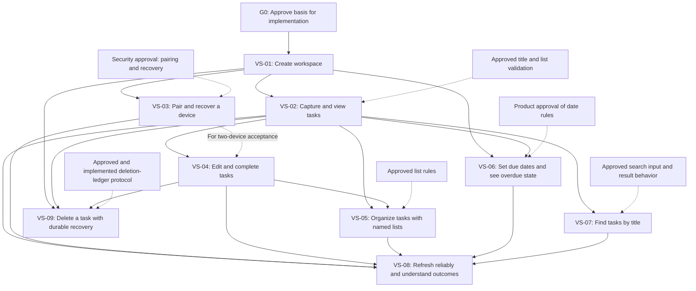

# Task Manager Implementation Roadmap

**Status:** G0 baseline evidence complete; G0 remains open pending explicit approval of VS-01 for implementation
**Version:** 0.4
**Date:** 2026-11-13  
**Planning owner:** TBD  
**Delivery dates, effort, budget, and named slice owners:** Not estimated; no team capacity or delivery constraints were supplied.

## 1. Scope and Sources

This plan sequences the proposed v1 task-manager scope as end-to-end vertical slices. Each slice delivers a user-observable behavior across the React client, ASP.NET Core API/application behavior, PostgreSQL persistence, and its tests. Shared authorization, validation, errors, logging, and persistence mechanisms should be reused; do not build the product in horizontal UI/API/database phases.

Sources:

- [Task Manager Product Requirements Specification](task-manager-requirements.md), v0.8. On 2026-11-13, @cjschaab confirmed they are the product owner and approved it as-is. The PRD defines functional requirements FR-01 through FR-13 and quality requirements QR-01 through QR-06.
- [Task Manager Architecture](task-manager-architecture.md), v0.2, approved by the requester on 2026-11-13. The technical lead confirmed architecture alignment with PRD v0.8. It selects one ASP.NET Core modular application serving React assets, PostgreSQL as the authoritative application store, and a separate protected deletion ledger. It does not authorize implementation by itself.
- Repository instructions select C#/ASP.NET Core, React/TypeScript, and PostgreSQL. The technical lead selected .NET 10 LTS / ASP.NET Core 10, PostgreSQL 18, EF Core 10 with Npgsql, React 19 with strict TypeScript and Vite, and Node.js 26 LTS. Selected test tooling is xUnit, `WebApplicationFactory`, PostgreSQL-backed integration tests using a disposable database, Vitest with React Testing Library, and Playwright. The baseline pins .NET SDK 10.0.403; Node.js 26.13.1; EF Core and `dotnet-ef` 10.0.15; Npgsql 10.0.3; React 19.3.1; TypeScript 7.0.2; Vite 8.3.8; Vitest 5.1.0; React Testing Library 16.3.3; Playwright 1.65.0; and PostgreSQL 18.7 (image pinned by digest).

The architecture document names PRD v0.6 as its product basis, while the current PRD is v0.8; the technical lead confirmed alignment with v0.8 on 2026-11-13. @cjschaab confirmed they are the product owner, security owner, and technical lead and approved the recorded PRD and VS-01 security recommendations. This repository is the application target. A reproducible baseline is now present; it contains no workspace behavior, application schema, or migration.

## 2. Planning Assumptions and Readiness Decisions

- The requester confirmed they are the product owner and approved PRD v0.8 as-is. The product-approval role for G0 is recorded as confirmed by the requester.
- No estimates, calendar dates, delivery commitments, staffing, hosting selection, or numeric performance commitments are inferred.
- Hosting can remain provider-neutral during early slices, but a provider and deployment details are required before pilot deployment.
- The security owner approved VS-01's account-free workspace bootstrap, initial credential lifecycle, and per-IP creation limits. Pairing/recovery and later operations, analytics/privacy, and accessibility decisions remain gated with their designated owners.
- The independent deletion ledger and the requirement to make acknowledged deletions durable before reporting success are high-risk dependencies. Their cross-store write, retry, retention, and restore-reconciliation protocol must be designed and tested before the deletion/restore slice.
- A single-user workspace and manually entered pairing code are draft product choices. The security owner approved account-free VS-01 bootstrap; pairing issuer eligibility, grant expiry, recovery proof, and related later-slice policies remain to be approved.

## 3. Readiness Gate

**Gate G0: Approve the basis for implementation.** This is a decision gate, not a horizontal implementation phase.

Required before the first product slice starts:

- Product owner @cjschaab confirmed approval of PRD v0.8 as-is on 2026-11-13; this records the accountable product approval for G0.
- The technical lead confirmed architecture alignment with PRD v0.8 and selected this repository as the application target. Supported runtime and data-access, migration, and test tooling are selected as recorded above; baseline evidence is recorded below.
- Security owner @cjschaab approved the VS-01 bootstrap policy: any visitor may create an isolated personal workspace without an account or invitation, and the creating browser receives the initial device credential after the workspace/default-list commit. Initial credentials expire after 30 days of inactivity or 180 days after issuance, whichever comes first; activity extends only the inactivity period, and logout or reported compromise revokes that device immediately. Enforce expiry only when recovery is available to prevent stranding a workspace. Limit workspace creation to 5 attempts per source IP per hour and 20 per source IP per day; return retry guidance and challenge repeated abuse. These IP limits are abuse controls, not authorization.
- The reproducible baseline is established as described in the evidence below. Explicit product/security/technical approval of the VS-01 specification for implementation remains required before G0 exits.

### Baseline evidence

The repository pins tool and dependency versions in `global.json`, `.nvmrc`, `Directory.Packages.props`, `dotnet-tools.json`, and the npm/NuGet lockfiles. `compose.yaml` pins PostgreSQL 18.7 by immutable image digest. Run `./scripts/verify.sh` from the repository root with the pinned Node.js and .NET SDK, Docker Compose, and Playwright's Chromium installed. The script runs clean locked restores, frontend unit/type checks and production build, .NET build and API tests, a PostgreSQL-backed connectivity smoke test, and a Playwright browser smoke against the ASP.NET Core host.

Verification run from a clean state on 2026-11-13 passed: frontend test (1 passed), .NET build (0 warnings, 0 errors), API/PostgreSQL tests (2 passed), and Playwright smoke (1 passed). The baseline check validates tool execution and host/database wiring only; it does not validate any VS-01 behavior. Re-run `./scripts/verify.sh` to reproduce the result.

Required before dependent slices or pilot, not necessarily before all feature work:

- Before device pairing: security approval of pairing issuer, grant expiry, recovery proof, and pairing/recovery rate-limit policy.
- Before task deletion/restore: technical and operations approval of ledger consistency, durability, retry, failure, retention, and restore protocol.
- Before analytics instrumentation or pilot: product, analytics/privacy, operations, and accessibility owners approve measurement/data handling and pilot acceptance criteria.

**Exit evidence:** decisions are recorded with owners; the PRD approval status and architecture/PRD version relationship are explicit; VS-01 is approved for implementation; the selected runtime/tooling has pinned versions and a reproducible build/test baseline. The baseline evidence is complete, but explicit VS-01 specification approval has not been recorded, so G0 remains open. If a later-gate decision remains open, defer only the affected slice and record the blocker; do not silently substitute a policy.

## 4. Dependency-Driven Vertical Slices

### Dependency graph

The graph shows the prerequisites already recorded in the slice table. Solid arrows
represent slice or readiness-gate dependencies; dashed arrows represent decisions
or protocols that must be resolved before the dependent slice can begin. VS-03 is needed for
VS-04's two-device end-to-end acceptance, not to begin VS-04 implementation.

| Order | Slice and user value | Traceability | Dependencies | Exit evidence |
| --- | --- | --- | --- | --- |
| VS-01 | **Create a workspace and enter it on the first authorized device.** A user can create an isolated workspace with its default `Tasks` list and reach the workspace through an approved initial-device flow. | FR-01, FR-02; QR-02 | G0; initial device/bootstrap flow approved. | Workspace and default list creation are atomic; authorization is derived from the verified device credential; cross-workspace access tests disclose no resource existence; failure leaves no successful partial workspace; approved credential lifecycle and per-IP workspace-creation limits are tested. |
| VS-02 | **Capture and view tasks.** A user can create a task in a list and distinguish task results, an empty list, and a failed load. | FR-03, FR-04 | VS-01; approved title/list validation. | Valid title and same-workspace list are required; task appears only after server confirmation; invalid/cross-workspace references create nothing; automated and browser tests cover empty/loading/error states. |
| VS-03 | **Pair and recover a device.** An authorized device presents a one-time code and a new device redeems it; the user can recover workspace access through the approved recovery flow. | FR-12; QR-03 | VS-01; security-approved pairing/recovery decisions. | Grant expiry/replay/issuer authorization and credential expiry/revocation are tested; secrets do not appear in URLs, logs, analytics, or browser storage; recovery rotation and revocation tests pass. |
| VS-04 | **Edit and complete tasks without losing newer work.** A user can edit task fields and change completion state; concurrent stale writes are reported as conflicts with the user's draft preserved. | FR-05, FR-11; QR-04 | VS-02; VS-03 for end-to-end two-device acceptance. | Version check and write are atomic; retries do not silently duplicate non-idempotent creates; stale updates cannot overwrite or recreate a removed task; client retains drafts and reports server-confirmed outcomes. |
| VS-05 | **Organize tasks with named lists.** A user can create/rename user lists and explicitly move tasks while the default list remains protected. | FR-07 | VS-02, VS-04; approved list rules. | List names follow approved validation; task/list association remains same-workspace; default-list protections and creation-order display work; move failures preserve confirmed state and user input. |
| VS-06 | **Set due dates and see overdue state.** A user can set/clear a date-only due date and see overdue status using the approved workspace time zone. | FR-08; QR-05 | VS-01 workspace time-zone behavior; VS-02 tasks; product approval of date rules. | Date remains unchanged across browser zones; incomplete tasks are overdue only under the approved date rule; completion does not clear due date; time-zone boundaries and zone changes are tested. |
| VS-07 | **Find tasks by title.** A user can search tasks within the authorized workspace. | FR-09 | VS-02; approved search input/result behavior. | Search is literal, case-insensitive substring matching; wildcard characters remain literal; results cannot cross workspace boundaries; empty query and ordering follow approved behavior. |
| VS-08 | **Refresh reliably and understand outcomes.** A returning user gets current confirmed data; loading, stale, validation, access, conflict, rate-limit, and service failures are distinguishable and accessible. | FR-10, FR-13; QR-01 | VS-02 through VS-07 for full workflow coverage. | Open/return/explicit refresh work without polling or offline writes; stale failures preserve prior view and drafts; status is keyboard/screen-reader accessible and not color-only; verify keyboard operation and visible focus. |
| VS-09 | **Delete a task with durable recovery guarantees.** A user explicitly deletes a task; the service reports success only after primary deletion and independent recovery evidence are durable. Restored data is not served until all acknowledged deletions and access state are reconciled. | FR-06; QR-06 | VS-01, VS-02, VS-04; approved and implemented deletion-ledger protocol. | Tests cover primary/ledger partial failure, retries, stale deletes, database restore, ledger unavailable/incomplete, and access-state reconciliation; service stays unavailable until reconciliation passes; no trash/undo/list deletion is introduced. |

### Slice completion standard

Every slice includes its client workflow, typed API contract, authorization and validation, application behavior, persistence change if required, user-visible success/failure states, and focused unit/integration/browser tests. Each mutation is workspace-scoped, parameterized, safe against ambiguous retries where applicable, and observable without logging task content or secrets. Add migrations and operational signals with the slice that needs them, not in a separate speculative infrastructure phase.

## 5. Cross-Cutting Validation and Pilot Readiness

- **Security and isolation:** test authorization on every protected read/write, workspace/list/task invariants, credential expiry/revocation, pairing replay, recovery rotation, rate-limit behavior, and sanitized failures. Zero confirmed cross-workspace disclosures is a security acceptance gate.
- **Data integrity and recovery:** test atomic workspace/default-list creation, version-checked updates/removals, retry behavior, migration compatibility, backup protection, independent ledger application, and fail-closed restore behavior.
- **Accessibility:** test semantic forms, labels, keyboard order, visible focus, screen-reader announcements, stale/error/conflict feedback, and the approved conformance scope.
- **Privacy and analytics:** collect only owner-approved aggregate events. Do not collect task content, credentials, recovery material, or unapproved stable identifiers. Establish activation and task-capture baselines before setting numeric targets.
- **Operational readiness:** select provider/topology; prove deployment and rollback; define health/readiness, monitoring, support ownership, backup/restore procedure, operational runbooks, rate limits, and pilot response process.
- **Performance and reliability:** establish representative pilot load and measure task-read latency, create/update latency, errors/conflicts, database load, and recovery outcomes before Operations approves numeric service targets.

## 6. Risks and Mitigations

| Risk | Impact | Mitigation / gate |
| --- | --- | --- |
| Architecture product basis cites PRD v0.6. | Changes in v0.7-v0.8, including time-zone, pairing, and deletion/restore decisions, may not be reflected in the approved design. | Technical lead performs a version-diff review and records whether architecture changes are needed before G0 exits. |
| The VS-01 specification lacks explicit implementation approval. | Starting the slice without approval would bypass the readiness gate. | Obtain and record explicit approval of the VS-01 specification before closing G0 or beginning product implementation. |
| Deletion acknowledgment spans PostgreSQL and an independent ledger. | Partial failure could acknowledge a deletion that restore later loses. | Design write ordering, idempotency, ledger retention, restore reconciliation, and failure semantics; prove with fault-injection/restore tests before VS-09 exits. |
| Pairing and recovery rules are security-sensitive but not fully approved. | Unauthorized workspace access or permanent user lockout. | Security owner approves pairing-grant issuance/expiry, recovery proof, and pairing/recovery abuse limits before VS-03; test the already approved VS-01 credential lifecycle separately. |
| Numeric service targets lack workload evidence. | Premature commitments or under-sized deployment. | Measure a representative pilot first; keep p95, availability, and recovery numbers provisional until Operations accepts evidence. |
| Cross-slice concurrency and team ownership are unknown. | Parallel work could conflict on shared contracts or schema. | Plan sequentially by default. Consider parallel work only after owners, shared API/data contracts, and independent testing are confirmed. |

## 7. Exit Criteria and Next Decisions

The project is ready for pilot only when:

- All nine slices meet their acceptance evidence and applicable cross-cutting checks.
- Product requirements and security decisions are formally approved by their accountable owners.
- Deletion-ledger durability and restore behavior pass failure-path tests.
- Hosting, operational ownership, support coverage, backup/restore, rate limits, and monitoring are approved and exercised.
- Accessibility scope passes the approved test plan.
- Pilot analytics are privacy-approved; activation and task-capture baselines are measured before numeric outcome targets are set.
- Operations reviews measured workload and explicitly approves or revises performance, availability, and recovery targets.

Immediate decision: product, security, and technical owners must explicitly approve the VS-01 specification for implementation. The runtime/tooling baseline is reproducible and recorded above. Keep the numeric service-wide capacity limit for workspace creation as a pilot-readiness decision based on measured capacity. G0 remains open until specification approval is evidenced. No dates or effort estimates should be committed until team capacity and a working codebase are known.
