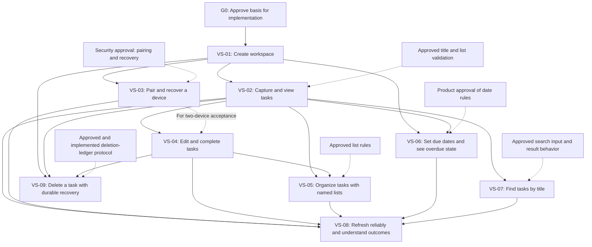

# Task Manager Implementation Roadmap

**Status:** Draft, conditional on PRD and cross-functional approvals; this plan does not authorize implementation  
**Version:** 0.2  
**Date:** 2026-11-13  
**Planning owner:** TBD  
**Delivery dates, effort, budget, and named slice owners:** Not estimated; no team capacity or delivery constraints were supplied.

## 1. Scope and Sources

This plan sequences the proposed v1 task-manager scope as end-to-end vertical slices. Each slice delivers a user-observable behavior across the React client, ASP.NET Core API/application behavior, PostgreSQL persistence, and its tests. Shared authorization, validation, errors, logging, and persistence mechanisms should be reused; do not build the product in horizontal UI/API/database phases.

Sources:

- [Task Manager Product Requirements Specification](task-manager-requirements.md), v0.8. The requester stated approval as-is on 2026-11-13; the organizational product-approval role is unspecified, so formal G0 approval is not verified. It defines candidate functional requirements FR-01 through FR-13 and quality requirements QR-01 through QR-06.
- [Task Manager Architecture](task-manager-architecture.md), v0.2, approved by the requester on 2026-11-13; organizational approval role is unspecified. It selects one ASP.NET Core modular application serving React assets, PostgreSQL as the authoritative application store, and a separate protected deletion ledger. It does not authorize implementation by itself.
- Repository instructions select C#/ASP.NET Core, React/TypeScript, and PostgreSQL while leaving versions, endpoint style, hosting provider, data-access, migration, and test libraries unselected.

The architecture document names PRD v0.6 as its product basis, while the current PRD is v0.8. The technical lead confirmed on 2026-11-13 that the architecture remains aligned with PRD v0.8. The requester selected this repository as the application target, but runtime and build/test tooling remain unselected; no application or test source is present.

## 2. Planning Assumptions and Readiness Decisions

- The requester stated approval of PRD v0.8 as-is; confirm the requester's organizational product-approval role before treating the G0 approval gate as complete.
- No estimates, calendar dates, delivery commitments, staffing, hosting selection, or numeric performance commitments are inferred.
- Hosting can remain provider-neutral during early slices, but a provider and deployment details are required before pilot deployment.
- Security, operations, analytics/privacy, accessibility, and product approval gates remain owned by their designated stakeholders.
- The independent deletion ledger and the requirement to make acknowledged deletions durable before reporting success are high-risk dependencies. Their cross-store write, retry, retention, and restore-reconciliation protocol must be designed and tested before the deletion/restore slice.
- A single-user workspace and manually entered pairing code are draft product choices. Security approval of issuer eligibility, expiry, recovery proof, secret handling, revocation scope, and numeric rate limits remains necessary.

## 3. Readiness Gate

**Gate G0: Approve the basis for implementation.** This is a decision gate, not a horizontal implementation phase.

Required before the first product slice starts:

- Confirm that the requester's stated approval of PRD v0.8 satisfies the authorized product-owner gate for scope, task/list rules, workspace/date behavior, and baseline-first measurement.
- The technical lead has confirmed architecture alignment and the requester selected this repository as the application target; the technical lead must still select supported runtime/tooling and establish a reproducible build/test baseline for the first slice.
- Confirm that the requester's stated security approval satisfies the security-owner gate for the initial-device policy. The approved draft policy is that any visitor may create an isolated personal workspace without an existing account or invitation, and the creating browser receives the initial device credential after successful creation. Confirm credential lifecycle and numeric rate limits before their applicable release gates.

Required before dependent slices or pilot, not necessarily before all feature work:

- Before device pairing: security approval of issuer, grant expiry, recovery, revocation, and rate-limit policy.
- Before task deletion/restore: technical and operations approval of ledger consistency, durability, retry, failure, retention, and restore protocol.
- Before analytics instrumentation or pilot: product, analytics/privacy, operations, and accessibility owners approve measurement/data handling and pilot acceptance criteria.

**Exit evidence:** decisions are recorded with owners; the PRD approval status and architecture/PRD version relationship are explicit; the first-slice build/test baseline is reproducible. If a required decision remains open, defer only the affected slice and record the blocker; do not silently substitute a policy.

## 4. Dependency-Driven Vertical Slices

### Dependency graph

The graph shows the prerequisites already recorded in the slice table. Solid arrows
represent slice or readiness-gate dependencies; dashed arrows represent decisions
or protocols that must be resolved before the dependent slice can begin. VS-03 is needed for
VS-04's two-device end-to-end acceptance, not to begin VS-04 implementation.

| Order | Slice and user value | Traceability | Dependencies | Exit evidence |
| --- | --- | --- | --- | --- |
| VS-01 | **Create a workspace and enter it on the first authorized device.** A user can create an isolated workspace with its default `Tasks` list and reach the workspace through an approved initial-device flow. | FR-01, FR-02; QR-02 | G0; initial device/bootstrap flow approved. | Workspace and default list creation are atomic; authorization is derived from the verified device credential; cross-workspace access tests disclose no resource existence; failure leaves no successful partial workspace. |
| VS-02 | **Capture and view tasks.** A user can create a task in a list and distinguish task results, an empty list, and a failed load. | FR-03, FR-04 | VS-01; approved title/list validation. | Valid title and same-workspace list are required; task appears only after server confirmation; invalid/cross-workspace references create nothing; automated and browser tests cover empty/loading/error states. |
| VS-03 | **Pair and recover a device.** An authorized device presents a one-time code and a new device redeems it; the user can recover workspace access through the approved recovery flow. | FR-12; QR-03 | VS-01; security-approved pairing/recovery decisions. | Grant expiry/replay/issuer authorization and credential expiry/revocation are tested; secrets do not appear in URLs, logs, analytics, or browser storage; recovery rotation and revocation tests pass. |
| VS-04 | **Edit and complete tasks without losing newer work.** A user can edit task fields and change completion state; concurrent stale writes are reported as conflicts with the user's draft preserved. | FR-05, FR-11; QR-04 | VS-02; VS-03 for end-to-end two-device acceptance. | Version check and write are atomic; retries do not silently duplicate non-idempotent creates; stale updates cannot overwrite or recreate a removed task; client retains drafts and reports server-confirmed outcomes. |
| VS-05 | **Organize tasks with named lists.** A user can create/rename user lists and explicitly move tasks while the default list remains protected. | FR-07 | VS-02, VS-04; approved list rules. | List names follow approved validation; task/list association remains same-workspace; default-list protections and creation-order display work; move failures preserve confirmed state and user input. |
| VS-06 | **Set due dates and see overdue state.** A user can set/clear a date-only due date and see overdue status using the approved workspace time zone. | FR-08; QR-05 | VS-01 workspace time-zone behavior; VS-02 tasks; product approval of date rules. | Date remains unchanged across browser zones; incomplete tasks are overdue only under the approved date rule; completion does not clear due date; time-zone boundaries and zone changes are tested. |
| VS-07 | **Find tasks by title.** A user can search tasks within the authorized workspace. | FR-09 | VS-02; approved search input/result behavior. | Search is literal, case-insensitive substring matching; wildcard characters remain literal; results cannot cross workspace boundaries; empty query and ordering follow approved behavior. |
| VS-08 | **Refresh reliably and understand outcomes.** A returning user gets current confirmed data; loading, stale, validation, access, conflict, rate-limit, and service failures are distinguishable and accessible. | FR-10, FR-13; QR-01 | VS-02 through VS-07 for full workflow coverage. | Open/return/explicit refresh work without polling or offline writes; stale failures preserve prior view and drafts; status is keyboard/screen-reader accessible and not color-only; verify keyboard operation and visible focus. |
| VS-09 | **Delete a task with durable recovery guarantees.** A user explicitly deletes a task; the service reports success only after primary deletion and independent recovery evidence are durable. Restored data is not served until all acknowledged deletions and access state are reconciled. | FR-06; QR-06 | VS-01, VS-02, VS-04; approved and implemented deletion-ledger protocol. | Tests cover primary/ledger partial failure, retries, stale deletes, database restore, ledger unavailable/incomplete, and access-state reconciliation; service stays unavailable until reconciliation passes; no trash/undo/list deletion is introduced. |

### Slice completion standard

Every slice includes its client workflow, typed API contract, authorization and validation, application behavior, persistence change if required, user-visible success/failure states, and focused unit/integration/browser tests. Each mutation is workspace-scoped, parameterized, safe against ambiguous retries where applicable, and observable without logging task content or secrets. Add migrations and operational signals with the slice that needs them, not in a separate speculative infrastructure phase.

## 5. Cross-Cutting Validation and Pilot Readiness

- **Security and isolation:** test authorization on every protected read/write, workspace/list/task invariants, credential expiry/revocation, pairing replay, recovery rotation, rate-limit behavior, and sanitized failures. Zero confirmed cross-workspace disclosures is a security acceptance gate.
- **Data integrity and recovery:** test atomic workspace/default-list creation, version-checked updates/removals, retry behavior, migration compatibility, backup protection, independent ledger application, and fail-closed restore behavior.
- **Accessibility:** test semantic forms, labels, keyboard order, visible focus, screen-reader announcements, stale/error/conflict feedback, and the approved conformance scope.
- **Privacy and analytics:** collect only owner-approved aggregate events. Do not collect task content, credentials, recovery material, or unapproved stable identifiers. Establish activation and task-capture baselines before setting numeric targets.
- **Operational readiness:** select provider/topology; prove deployment and rollback; define health/readiness, monitoring, support ownership, backup/restore procedure, operational runbooks, rate limits, and pilot response process.
- **Performance and reliability:** establish representative pilot load and measure task-read latency, create/update latency, errors/conflicts, database load, and recovery outcomes before Operations approves numeric service targets.

## 6. Risks and Mitigations

| Risk | Impact | Mitigation / gate |
| --- | --- | --- |
| PRD v0.8 remains unapproved. | Work may implement a scope the product owner has not accepted. | Keep G0 blocking feature slices; retain traceability and update the plan after approval. |
| Architecture product basis cites PRD v0.6. | Changes in v0.7-v0.8, including time-zone, pairing, and deletion/restore decisions, may not be reflected in the approved design. | Technical lead performs a version-diff review and records whether architecture changes are needed before G0 exits. |
| No application source or build/test baseline is present in the workspace. | Tooling, integration points, and implementation readiness are unknown. | Locate/create the authorized application repository and establish one reproducible build/test check in VS-01; do not assume project layout or libraries. |
| Deletion acknowledgment spans PostgreSQL and an independent ledger. | Partial failure could acknowledge a deletion that restore later loses. | Design write ordering, idempotency, ledger retention, restore reconciliation, and failure semantics; prove with fault-injection/restore tests before VS-09 exits. |
| Pairing and recovery rules are security-sensitive but not fully approved. | Unauthorized workspace access or permanent user lockout. | Security owner approves grant issuance, expiry, secret lifecycle, revocation, abuse limits, and recovery tests before VS-03. |
| Numeric service targets lack workload evidence. | Premature commitments or under-sized deployment. | Measure a representative pilot first; keep p95, availability, and recovery numbers provisional until Operations accepts evidence. |
| Cross-slice concurrency and team ownership are unknown. | Parallel work could conflict on shared contracts or schema. | Plan sequentially by default. Consider parallel work only after owners, shared API/data contracts, and independent testing are confirmed. |

## 7. Exit Criteria and Next Decisions

The project is ready for pilot only when:

- All nine slices meet their acceptance evidence and applicable cross-cutting checks.
- Product requirements and security decisions are formally approved by their accountable owners.
- Deletion-ledger durability and restore behavior pass failure-path tests.
- Hosting, operational ownership, support coverage, backup/restore, rate limits, and monitoring are approved and exercised.
- Accessibility scope passes the approved test plan.
- Pilot analytics are privacy-approved; activation and task-capture baselines are measured before numeric outcome targets are set.
- Operations reviews measured workload and explicitly approves or revises performance, availability, and recovery targets.

Immediate decisions: approve PRD v0.8; reconcile the architecture's PRD v0.6 reference; identify the application repository and technical lead; assign owners for G0 and each gated decision. No dates or effort estimates should be committed until team capacity and a working codebase are known.
